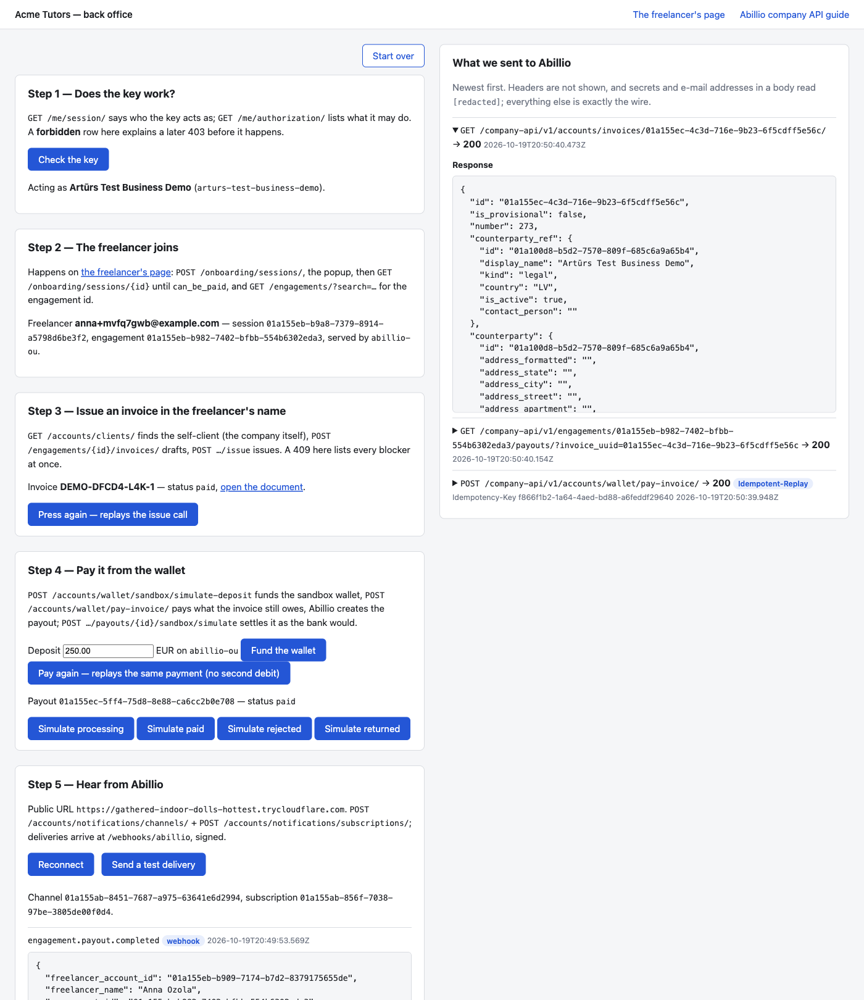
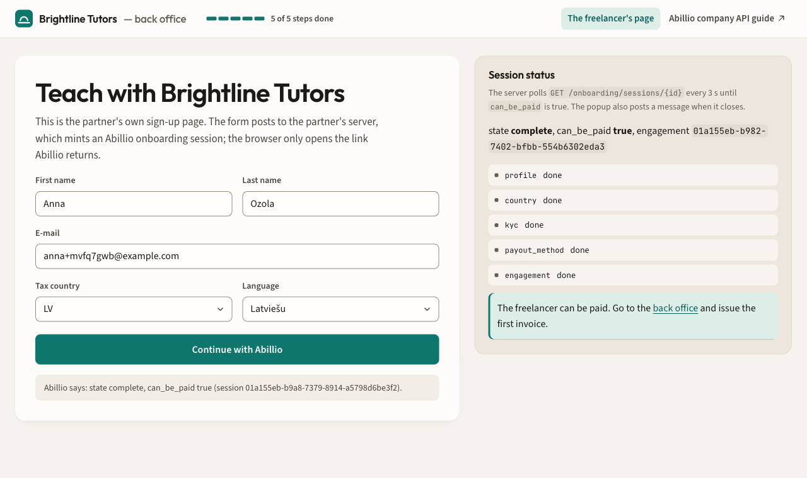

# Abillio gateway example

A company's side of an Abillio integration, small enough to read in one sitting:
a freelancer joins through the Abillio popup, the company issues an invoice in
their name, pays it from its wallet, the payout goes out, and webhooks tell the
company what happened. Every call to Abillio is shown on the page as it is made.
A hosted copy runs at https://demo.abillio.dev.



It is one Node process with two pages: the company's back office at `/` and the
freelancer's sign-up page at `/join`. It talks to Abillio's company API, signs
every request itself and keeps what a real integration would keep in its own
database in one readable file, `data/state.json`. The
[partner integration guide](https://backend.abillio.dev/company-api/) is the
reference; this repository is the worked example of its happy path, and each
chapter below links back to it.

## Run it

You need Node 22.12 or newer and a key for a **sandbox** company account. Ask
Abillio for the demo key, or for an invitation to the staging dashboard at
https://new.abillio.dev: register a business account there, open its sandbox
twin and create an API key. A sandbox account runs the real plans and the real
tax rules, moves no money, and is not held back by its own verification, so the
whole path works on day one.

```bash
cp .env.example .env    # then fill in the key, see below
npm install
npm start               # http://localhost:4000
```

The settings live in `.env`, which the npm scripts load with `node --env-file`:

| Variable | What it is |
|---|---|
| `ABILLIO_API_URL` | The company API. Defaults to the staging host, `https://backend.abillio.dev/company-api/v1`; production is the same path on the host Abillio gives you with the key. |
| `ABILLIO_API_KEY_ID` | The key id shown on the API key page. |
| `ABILLIO_PRIVATE_KEY` | The 64 hex characters Abillio shows once when the key is created: the raw Ed25519 seed, not a PEM file. It never reaches a page, a log or the trace. |
| `ABILLIO_ACCOUNT` | Only if the key reaches more than one account: the account UUID or slug to act as. |
| `PUBLIC_URL` | A public https URL of this server, for webhooks (step 5). Leave it empty and the server polls instead. |
| `PORT` | 4000 unless you say otherwise. |
| `STATE_FILE` | Where the state lives; `data/state.json` unless you say otherwise. |
| `ALLOW_PRODUCTION` | Leave it unset. `1` lets the buttons write to a production account (see [Keep it safe](#keep-it-safe)). |

The other commands: `npm test` runs the unit tests (no network; the signing and
the webhook verification are checked against vectors produced by Abillio's own
signer), `npm run typecheck` runs `tsc`, `npm run smoke` runs the story without a
browser (see [The smoke test](#the-smoke-test)) and `npm run tunnel` prints how
to give this machine a public URL.

## Run with Docker

```bash
docker build -t abillio-gateway-example .
docker run --rm -p 4000:4000 --env-file .env -v gateway-state:/data abillio-gateway-example
```

The image is published for every `v*` tag as
`ghcr.io/abill-io/abillio-gateway-example:<tag>`, for amd64 and arm64, and
`:latest` follows the highest release; a tag is published only once the tests,
the typecheck and a start of the image itself (`/healthz`) have passed. It runs
the same `server.ts` as `npm start`, as the `node` user, and keeps
the state in the `/data` volume (`STATE_FILE=/data/state.json`), so a directory
mounted there has to be writable by uid 1000. Docker reads `.env` literally:
leave the values unquoted. With `ABILLIO_API_KEY_ID` or `ABILLIO_PRIVATE_KEY`
empty the container idles and says so, rather than failing to start.

## Hosted demo

Abillio runs one instance of this repo at https://demo.abillio.dev against a
sandbox account, with real webhooks. Everyone sees the same walk; **Start over**
resets it. It is the same code as this repo, pinned to a tag.

The demo is shared, and so is what you type into it: the name and address on
the join page show up for everyone who opens it after you, in the session
status, in step 2, in the trace (the request body as typed, and the
`GET /engagements/?search=<address>` lookup) and in `GET /api/state`. Keep the
made-up name and the `@example.com` address the form suggests, and use test
details in the popup; the join page says the same.

## Keep it safe

Two files hold secrets, and neither belongs in a repository. `.env` holds
`ABILLIO_PRIVATE_KEY`, the seed that signs as your company. `data/state.json`
holds the webhook signing secret in clear, and whoever has it can forge a
delivery your receiver will believe; it also holds the full API key id and the
freelancer's onboarding link, which the page cuts down to their last four
characters. Both are in `.gitignore`, but
only at their default paths: a `STATE_FILE` somewhere else is not ignored, so
keep it out of the repository yourself.

Use a sandbox key only. The sample mints links, invoices and payments with
whatever key it is given, so every button that writes to Abillio first asks
what **Check the key** stored: until it has seen a sandbox account, the button
refuses and sends nothing, and on a production account it says *This back
office runs against sandbox accounts only (the key belongs to a production
account)*. A check counts only for the key and the `ABILLIO_ACCOUNT` it was made
with: change either in `.env` and the page shows no account, its buttons
disabled until a new check, and a check that fails forgets the account.
`ALLOW_PRODUCTION=1` in `.env` lifts the guard, for a partner who has read the
code and means to run it against real money; the smoke test refuses a production
account regardless.

## How it is put together

TypeScript runs directly (`node --experimental-strip-types`), so there is no
build step, and the only runtime dependency is [Hono](https://hono.dev) with its
Node adapter. `server.ts` holds the routes. Each step lives in its own file
under `steps/`, which makes the calls and nothing else (no HTML), so each
chapter below has one file to read next to it, and the smoke script calls the
same functions in the same order.
`lib/abillio.ts` is the only module that talks to Abillio: it signs, sends and
records. `lib/store.ts` reads and writes `data/state.json`, always whole,
through a temporary file and a rename, so a crash mid-write leaves the previous
version intact. `lib/webhooks.ts` verifies and deduplicates deliveries. `views/`
renders the two pages: the five steps on a numbered rail, with the progress line
in the top bar read off the stored state, and the trace in a console beside
them. `public/` holds the popup script, the page script, the stylesheet (plain
CSS, no build) and the three fonts, Outfit, Source Sans 3 and JetBrains Mono,
self-hosted under the SIL Open Font License with each licence beside its file in
`public/fonts/`: the pages load nothing from anywhere else.

The right-hand column of the back office, **What we sent to Abillio**, is the
trace of the last fifty calls, newest first: method, path, request body, status
and response body as they went over the wire, minus what the page must not show
to whoever opens it. A `GET` that comes back with the same answer as the last
time it was asked (the poller and the join page's status check, every few
seconds) folds into that entry, which moves up with a ×N count, so the walk's
own calls stay in view. Headers are never recorded, and any body key named
`secret`, `private_key`, `password`, `token` or `user_email` reads `[redacted]`.
Personal data reads `[redacted]` too, by the name of its key: in an answer from
Abillio, the keys named for an e-mail address (`email`, `accounting_email`,
`paid_copy_emails`, `recipient_email`), a first, last or legal name, a contact
person, a phone number, an address, a bank account, a personal code or a
registration or VAT number, as `lib/abillio.ts` lists them
(`GET /accounts/clients/` returns a row for the account owner's own company,
with the owner's e-mail and address on it), and the onboarding link the mint
answers with (`url`), which is the freelancer's to open and is spent on its
first open; in a request, only the keys no form
of the sample types, so the e-mail and names typed on the join page show as
typed. Display names (`name`, `display_name`) are not masked: they are the
company's own name and the name typed on the join page. Nor is free text:
`internal_notes`, `notes`, `invite_message` and `description` stay readable
whatever they say, so keep personal data out of them. The
**What we store** panel shows `data/state.json`, with the webhook signing
secret, the API key id and the freelancer's onboarding link (`session_url`) cut
down to their last four characters; `GET /api/state` and `GET /api/trace` serve
the same two things as JSON. The link reaches only the browser that pressed
**Continue with Abillio**, in the `/join` answer. On the hosted copy everyone
shares one walk: the state, the trace and the made-up `@example.com` addresses
in them are the same for every visitor, and **Start over** starts the walk over
for everybody.

### Idempotency, the one rule every step follows

Abillio stores the answer to every `POST` and `PATCH` that carries an
`Idempotency-Key` and replays it, with `Idempotent-Replay: true`, when the same
key comes back with the same body ([guide: retrying safely](https://backend.abillio.dev/company-api/#idempotency)).
The sample's client refuses to send a `POST` or `PATCH` without a key, and every
key is stored in `data/state.json` under the action it belongs to:
`onboard:<e-mail>:<digest of the body>`, `draft:<engagement>`,
`issue:<invoice>`, `pay:<invoice>`, `simulate:<payout>:<outcome>`,
`webhook:channel` and `webhook:subscription`. A key is claimed in the store
**before** the call, so two overlapping presses, a restart or a crash mid-call
send the same key instead of minting a second one.

What happens to a key afterwards depends on the answer. After a success it is
kept, and pressing the button again replays the first answer: the trace marks it
**Idempotent-Replay**, and no second invoice or payment exists. After a refusal
Abillio composed itself (a 4xx in its `error` envelope) the key is forgotten,
because Abillio keeps a spent key and would answer a retry with 409, so the next
press is a new attempt. After a 5xx or a network failure the outcome is
unknown: the key is kept, and so is the request body that went out under it
(`invoice_request`, `webhook_request`), so the next press sends exactly the same
bytes under the same key, even on another day, since a different body under a
key Abillio holds is refused for good.

An answer from Abillio's idempotency layer is no verdict on the request either.
Its code starts with `idempotency_` (an older backend answers a bare
`{"detail": …}` instead), and it says Abillio still holds the key for an earlier
attempt, which may have done its work. The sample keeps the key, and what comes
next depends on the code
([guide: questions partners ask](https://backend.abillio.dev/company-api/#faq)):

- `idempotency_in_progress`: the earlier attempt is still running. Press again a
  little later, and once that attempt has succeeded the identical request gets
  its answer as a replay. A claim that never finishes (after a 5xx on an action
  that is not atomic, below) answers this for five minutes, and
  `idempotency_reconciliation_required` after that.
- `idempotency_key_reused` (the key went out with another body),
  `idempotency_replay_forbidden` (what the stored answer was bound to has
  changed: the key was rotated, or the engagement's status or mandate moved)
  and `idempotency_reconciliation_required` (the earlier attempt never
  finished, or its answer cannot be served) never turn into a replay. Pressing
  again answers the same for good, and the claim does not expire into
  permission to retry. Read the resource back instead (for an issue or a
  payment, `GET /accounts/invoices/{id}/`), and send the action under a new key
  only once the read-back shows it did not happen.

The error box says the same under each code. In the sample, **Start over** is
the way out of a key Abillio holds for good: it clears every stored key except
the webhook's (see [Start over](#start-over)). One walk that ends there:
freelancer A, then B, then A again. A's draft key is still stored, while the
invoice and the request that went out under it were cleared with B, so A's new
request (another day, another description) goes out under the old key and
answers `idempotency_key_reused`.

A few actions deliberately take a fresh key on every press, because each press
is meant to run again: the sandbox deposit, the test delivery, Start over, and
Reconnect's `PATCH` in step 5 (it sets a destination, the secret and
`is_enabled`, so it comes out the same however often it is sent). Two more are
events rather than states, so
their key is spent on any settled answer, a success included, and only an
unknown outcome keeps it for the identical retry: the payout simulation, so
`paid` after `returned` plays again instead of replaying the first `paid`, and
the onboarding mint, because its link is single-use and the one answered before
may already have been opened, so every press of **Continue with Abillio** mints
a new link.

Two cases are worth knowing before you copy the pattern. Issuing and paying
are not atomic (drafting is: a draft that failed leaves nothing behind, and its
key can be used again). After a 5xx on the issue call or on the payment,
Abillio keeps the claim, so a retry first answers `idempotency_in_progress` for
five minutes and then `idempotency_reconciliation_required` until an operator
settles it. Read the invoice back with `GET /accounts/invoices/{id}/` rather
than pressing again: it says whether it was issued, or paid. And `pay:<invoice>`
replays the first payment's success for as long as the key is stored, so if an
invoice ever owes money again (after a chargeback), a second real payment needs
a new key.

The sample never retries anything on its own. The stored key is what makes a
person's retry safe; an automatic retry would hide the cause of the failure from
the person who has to fix it.

The responses in the chapters below were captured on Abillio's staging sandbox
while the sample was walked twice: once without a public URL (the examples in
step 2) and once through a tunnel (steps 3 to 5). Ids are shortened, and long
answers are abridged to the fields the sample reads.

## Step 1 — Does the key work?

The goal is to prove that the key signs correctly and may do what the next four
steps do, before anything else is tried (`steps/01-key.ts`). **Check the key** sends two read-only
calls: `GET /me/session/` says which account the key acts as, and
`GET /me/authorization/` is the key's own preview of what it may do, one entry
per action. Every request carries four headers, `X-API-Key`, `X-API-Timestamp`
(unix seconds), `X-API-Signature` (lowercase hex Ed25519 over
`{timestamp}{account}{method}{path}{body}`, with the full path including the
query string) and `X-Account` when you set one; `lib/abillio.ts` builds them
([guide: authentication](https://backend.abillio.dev/company-api/#auth)).

This is `GET /me/session/`, without the e-mail of the key's user, which the
sample keeps off the page:

```json
{
  "account": {
    "id": "01a100d8-b580-…",
    "name": "Artūrs Test Business Demo",
    "slug": "arturs-test-business-demo",
    "kind": "company",
    "is_sandbox": true
  },
  "is_owner": false
}
```

and three of the entries `GET /me/authorization/` returned:

```json
{
  "account_kind": "company",
  "surface": "company_api",
  "actions": {
    "freelancers.invite": { "state": "available", "required": [], "reason_code": null, "money_limits": [] },
    "wallet.payment.execute": {
      "state": "context_required",
      "required": ["command", "locked_quote", "money_context", "normalized_invoice_set", "resource"],
      "reason_code": null,
      "money_limits": [{ "basis": "account_debit", "currency": "EUR", "maximum": "5000.00", "unlimited": false, "source": "restriction" }]
    },
    "credentials.create": { "state": "forbidden", "required": [], "reason_code": "credential_mode_forbidden", "money_limits": [] }
  }
}
```

The page lists the thirteen actions the steps use (`NEEDED_ACTIONS` in
`steps/01-key.ts`) first and folds the rest away. `context_required` is a yes:
the call itself carries what the action needs, such as the invoice to pay.
The step writes `account: { id, name, slug, is_sandbox, key_id, env_account }`
to `data/state.json`, the last two being the key and the `ABILLIO_ACCOUNT` the
check was made with. Step 3 needs the account id to find the self-client, and
every button that writes to Abillio needs `is_sandbox` to be true for the key
it runs with (see [Keep it safe](#keep-it-safe)). A check that fails clears the
account.

**What can go wrong.** A 401 means Abillio refused the signature, and the page
says the usual causes: this machine's clock is more than 300 seconds off,
`ABILLIO_PRIVATE_KEY` is not the seed that was shown when the key was minted,
or the key is bound to another account than `ABILLIO_ACCOUNT`. A key past its
validity date reads the same way. A `forbidden` row explains a 403 in a later
step before it happens; ask for the action on the key, or use a key that has it.
If the server will not even start, `.env` is the problem: the seed must be the 64
hex characters, and the key id must be set.

## Step 2 — The freelancer joins

The goal is to bring a freelancer onto Abillio without sending them away from
the partner's site, and to learn the engagement that later steps act on
(`steps/02-onboard.ts`, `views/join.ts`, `public/popup.js`;
[guide: gateway onboarding](https://backend.abillio.dev/company-api/#gateway)).
The freelancer fills in the partner's own form on `/join`; the partner's server
mints an onboarding session, and the browser only opens the link Abillio
returns. The form suggests a fresh made-up `anna+…@example.com` on every load,
never the address of whoever joined before.

`POST /onboarding/sessions/`, keyed on the address and a digest of the exact
body, with the key spent as soon as Abillio answers (see
[Idempotency](#idempotency-the-one-rule-every-step-follows)):

```json
{
  "email": "anna+de-mvfq16f2@example.com",
  "locale": "en",
  "return_url": "http://localhost:4000/back",
  "prefill": { "first_name": "Anna", "last_name": "Ozola", "tax_country": "DE" }
}
```

answered with `201`:

```json
{
  "session_id": "01a155e7-3f25-…",
  "url": "https://new.abillio.dev/s/<token>",
  "expires_at": "2026-10-20T20:43:00.773461Z",
  "status": "awaiting_freelancer",
  "purpose": "onboarding",
  "mode": "onboarding"
}
```

`public/popup.js` opens the popup synchronously on the click, as
`window.open('about:blank', 'abillio', 'popup,width=520,height=760')`, so the
browser allows it, and points it at `url` once the server has answered. In the
popup the freelancer gives consent, verifies their identity and adds a payout
method. The last page offers **Back to** and the company's name; pressed, the
popup posts one message to the window that opened it and closes itself:

```json
{ "source": "abillio", "session_id": "01a155e7-3f25-…", "purpose": "onboarding", "state": "complete", "can_be_paid": true }
```

The message goes to the origin of `return_url`, so the page that opened the
popup must be on that origin. With a **sandbox** key `return_url` may be
`http://localhost:<port>/back` or `http://127.0.0.1:<port>/back`, so this step
needs no tunnel; production accounts need https. When `PUBLIC_URL` is set,
`return_url` becomes `PUBLIC_URL/back`, so open the pages at that address too,
or the message is dropped (the page's own status poll still shows the outcome). `popup.js`
trusts the message only when `event.origin` is Abillio's (taken from the session
url) and `data.source` is `"abillio"`.

Meanwhile the page asks the server every three seconds (from the moment it
opens, when a session is already stored), and the server asks
`GET /onboarding/sessions/{session_id}`. This is the last answer of the walk:

```json
{
  "state": "complete",
  "can_be_paid": true,
  "requirements": [
    { "key": "profile", "state": "done" },
    { "key": "country", "state": "done" },
    { "key": "kyc", "state": "done" },
    { "key": "payout_method", "state": "done" },
    { "key": "engagement", "state": "done" }
  ],
  "purpose": "onboarding",
  "mode": "onboarding"
}
```

The session carries no engagement id, so once it has left `awaiting_freelancer`
the server looks the engagement up by the address the link was minted for,
`GET /engagements/?search=<e-mail>`, and keeps the row whose
`counterparty.email` matches. Reading the session is the key's
`freelancers.view`; the lookup is `engagements.view`, a grant of its own, and
without it the page's note says the status check failed. Abridged, at the
moment of the first lookup:

```json
{
  "items": [{
    "id": "01a155e7-3efa-…",
    "status": "invited",
    "counterparty": {
      "email": "anna+de-mvfq16f2@example.com",
      "tax_country": "DE",
      "servicing_company": { "slug": "abillio-ou", "name": "abillio OÜ", "country": "EE" }
    },
    "compliance": { "kyc_status": "not_started", "payout_ready": false, "can_be_paid": false }
  }],
  "count": 1
}
```

The step writes `freelancer: { email, session_id, session_url, engagement_id,
servicing_company_slug }`. The serving company decides which balance the
company's payment draws on in step 4.



In the sandbox the address is never looked up, written to or mailed: the
session creates a sandbox freelancer who walks every step a newcomer does.
Identity is approved the moment it is started (**Auto-approve (demo account)**),
and a bank account proven by a statement verifies as it is saved. A freelancer
served by the Latvian cooperative also pays the €1 membership fee, which the
popup plays with a **Simulate payment** action.

**What can go wrong.** A blocked popup: the page then says so and shows the
link to open by hand. A malformed address is refused before Abillio is called,
and an error from Abillio comes back to the page as its code and message. The
link is single-use and valid for 24 hours, so each press mints a new one:
minting again for the same address gives a new link on the same engagement,
and the freelancer continues where they stopped. Only a mint whose answer was
lost keeps its key, and pressing again with the identical form replays it; a
changed form is a new attempt under a new key, since Abillio refuses a
different body under a key it holds. An address with nothing left to complete
answers `409 requirements_complete`. A production account refuses an `http`
return URL with a 400.

## Step 3 — Issue an invoice in the freelancer's name

The goal is one invoice in the freelancer's name, billed to the company itself
and issued (`steps/03-issue.ts`; [guide: issuing](https://backend.abillio.dev/company-api/#issuing)).
Two calls, so a draft can be looked at before it becomes a document; each has
its own key.

First the self-client, the client row that is the company itself: Abillio
provisions one for every verified company account, and the list cannot be
filtered to it, so `GET /accounts/clients/?limit=100` and keep the row whose
`company_account_id` is your own account id. Abridged:

```json
{
  "id": "01a100d8-b5d2-…",
  "name": "Artūrs Test Business Demo",
  "kind": "legal",
  "is_owned": true,
  "company_account_id": "01a100d8-b580-…"
}
```

Then the draft, `POST /engagements/{engagement_id}/invoices/` under
`draft:<engagement>`. The request is dated once and stored in `invoice_request`
before the first call, so a retry sends exactly this:

```json
{
  "client_uuid": "01a100d8-b5d2-…",
  "items": [{ "description": "Tutoring, October", "quantity": "1", "unit_price": "100.00", "unit_code": "HUR" }],
  "currency_code": "EUR",
  "issued_date": "2026-10-19",
  "due_date": "2026-11-02",
  "language": "en"
}
```

`unit_code` is a UN/ECE Rec 20 code, which e-invoicing requires on every line.
The answer is a `201` draft, abridged:

```json
{
  "id": "01a155ec-4c3d-…",
  "status": "draft",
  "issuer_ref": { "display_name": "Anna Ozola", "kind": "freelancer" },
  "issued_by_ref": { "display_name": "Artūrs Test Business Demo", "kind": "company" },
  "amounts": {
    "total_before_tax": { "amount": "100.00", "currency": "EUR" },
    "total": { "amount": "124.00", "currency": "EUR" },
    "net_payout": { "amount": "95.00", "currency": "EUR" }
  }
}
```

Last, `POST /engagements/{engagement_id}/invoices/{invoice_id}/issue` under
`issue:<invoice>`, with no body. Issuing to the self-client also approves the
invoice, so it is waiting for payment straight away:

```json
{
  "id": "01a155ec-4c3d-…",
  "invoice_number": "DEMO-DFCD4-L4K-1",
  "status": "pending",
  "public_url": "https://new.abillio.dev/invoice/e4a1e2bf-…"
}
```

The step writes `invoice: { id, number, status, public_url }`. An engagement is
drafted for once: with a draft stored, a press only sends the issue call, and
after issuing, the button replays that call, which shows up in the trace as
**Idempotent-Replay**.

**What can go wrong.** A 409 on the issue call lists every reason at once in
`error.blockers`: the engagement or the mandate (`engagement_inactive`,
`mandate_missing`), your company (`company_unverified`, `kyc_missing`), the
freelancer (`kyc_missing`, `invoicing_blocked`) and the invoice
(`payout_method_missing`, `documents_unsigned`, …). The page shows them as a
checklist; nothing was written, so fix them and press again, and the stored
draft is issued. Do not pre-check: the issue call decides when it runs. A 422
names a field (an unknown `unit_code`, a malformed amount). After a 5xx on the
issue call, read the invoice back instead of retrying (see
[Idempotency](#idempotency-the-one-rule-every-step-follows)). "No self-client"
means the company account is not verified yet.

## Step 4 — Pay it from the wallet

The goal is to pay what the invoice owes from the company's Abillio wallet, let
Abillio create the freelancer's payout on its own, and, in the sandbox, decide
what the bank does with it (`steps/04-pay.ts`; guide: paying what is billed to
you, in [issuing](https://backend.abillio.dev/company-api/#issuing), and the
deposit and payout simulators, in [sandbox](https://backend.abillio.dev/company-api/#sandbox)).

**Fund the wallet** is the sandbox's stand-in for a bank transfer,
`POST /accounts/wallet/sandbox/simulate-deposit` under a fresh key each press:

```json
{ "amount": "250.00", "currency": "EUR", "company": "abillio-ou" }
```

It answers with one balance row per serving company and currency, abridged:

```json
[
  { "company_slug": "abillio-ou", "available": { "amount": "376.00", "currency": "EUR" } },
  { "company_slug": "abillio-ks", "available": { "amount": "66.90", "currency": "EUR" } }
]
```

The deposit goes to the row of the company that serves the freelancer
(`servicing_company_slug` from step 2), because the payment draws on the row of
the company that issued the invoice, and another company's row does not help.

**Pay** is `POST /accounts/wallet/pay-invoice/` under `pay:<invoice>`:

```json
{ "invoice_uuid": "01a155ec-4c3d-…" }
```

```json
{ "operation_id": "01a155ec-5ecb-…", "created": true }
```

It debits what the invoice still owes, so a part-paid invoice is settled for the
remainder and never twice. Pressing again replays this exact answer with
`Idempotent-Replay: true`, which is what the back office screenshot above shows.
Abillio then creates the automatic payout inside the same request, and the
sample finds it with `GET /engagements/{engagement_id}/payouts/?invoice_uuid={invoice_id}`
(abridged):

```json
{
  "items": [{
    "id": "01a155ec-5ff4-…",
    "invoice_uuid": "01a155ec-4c3d-…",
    "status": "pending",
    "kind": "profit_share",
    "net_amount": { "amount": "95.00", "currency": "EUR" },
    "payout_method": { "kind": "sepa", "destination": "DE** **** **** 3000", "status": "verified" }
  }],
  "count": 1
}
```

and reads the invoice back with `GET /accounts/invoices/{invoice_id}/`, which
now says `"status": "paid"` and `"paid_via": "wallet"`. In the sandbox the four
**Simulate** buttons send
`POST /engagements/{engagement_id}/payouts/{payout_id}/sandbox/simulate` with
`{ "outcome": "paid" }` (or `processing`, `rejected`, `returned`). The simulator
runs the real lifecycle and emits the real events; it answered with the payout,
now `"status": "paid"`, and the sample stores a fresh read of it.

The step writes the invoice's new status and `payout: { id, status }`.

**What can go wrong.** `409 insufficient_balance`: the balance row of the
company that issued the invoice cannot cover it, even if another company's row
could; nothing is written, so fund that row and press again. `409 not_payable`:
something holds the invoice (a document to sign, a check in progress), and its
`blockers` say what. A `sent` invoice waits for its acceptance, and any status
that cannot be paid answers 400. If no payout appears after a payment, the
freelancer could not be paid out automatically. Abillio creates the payout only
for a verified payout method in the invoice currency; without one, or when it
refused the payout, the money waits in the freelancer's balance, and Abillio
raises `wallet.auto_payout_blocked` with the `invoice_uuid`. It lands in your
company's Abillio inbox, and on any webhook whose subscription lists it (the
sample's lists the engagement events, so it does not); the page says that no
payout was created. A payment that puts the invoice on hold (one of the
compliance checks it re-runs failed, say your company's register check needs
renewing) creates no payout either: the invoice reads `held`, nothing pays out
until Abillio's team releases it, and you hear
`engagement.invoice.status_changed` rather than `wallet.auto_payout_blocked`. A
simulated outcome that cannot follow where the payout stands is a
`409 payout_transition_not_allowed`, and a key with a payout cap refuses a
bigger payment with `409 api_key_payout_limit`.

## Step 5 — Hear from Abillio

The goal is to learn what happened without asking: webhooks when the server has
a public URL, and polling when it has none (`steps/05-events.ts`,
`lib/webhooks.ts`; [guide: webhooks](https://backend.abillio.dev/company-api/#webhooks)).

**With a public URL.** Run `npm run tunnel` for the two one-liners
(`cloudflared tunnel --url http://localhost:4000` or `ngrok http 4000`), put the
https URL the tunnel prints in `.env` as `PUBLIC_URL`, restart, and open the
pages at that URL. **Connect webhooks** then sends up to three calls, storing each answer
as it comes, so a press after a partial failure carries on where the last one
stopped. The channel, under `webhook:channel`, with a secret generated here (32
random bytes as hex) and stored, because Abillio never returns it:

```
POST /accounts/notifications/channels/
{ "name": "gateway-example", "kind": "webhook", "destination": "https://<your public URL>/webhooks/abillio",
  "secret": "<64 hex characters>", "is_enabled": true }
```

When the channel already exists, **Reconnect** sends
`PATCH /accounts/notifications/channels/{channel_id}` with
`{ "destination": …, "secret": <the stored secret>, "is_enabled": true }` under
a fresh key, on every press: it moves the channel when this server's URL
changed (a quick tunnel gets a new one on every start), and it re-enables a
channel Abillio disabled after ten failed deliveries in a row. This is the
answer from the walk, which moved the channel after Start over and so also
shows that the channel outlives a sandbox reset:

```json
{
  "id": "01a155ab-8451-…",
  "name": "gateway-example",
  "kind": "webhook",
  "destination": "https://gathered-indoor-dolls-hottest.trycloudflare.com/webhooks/abillio",
  "is_enabled": true,
  "created_at": "2026-10-19T19:37:46.321139Z",
  "updated_at": "2026-10-19T20:47:42.636044Z"
}
```

Then the subscription, `POST /accounts/notifications/subscriptions/` under
`webhook:subscription`, with `{ "name": "gateway-example", "channel_uuids":
[<channel_id>], "event_types": […] }`. A subscription keeps exactly the events
it lists, so the sample names every engagement event the guide documents plus
`bulk_invoice.completed`. As Abillio holds it:

```json
{
  "id": "01a155ab-856f-…",
  "channel_ids": ["01a155ab-8451-…"],
  "name": "gateway-example",
  "event_types": [
    "engagement.onboarding.started", "engagement.onboarding.completed", "engagement.kyc.updated",
    "engagement.requirements_updated", "engagement.commission.accepted", "engagement.commission.credited",
    "engagement.commission.reversed", "engagement.invoice.confirmed", "engagement.invoice.status_changed",
    "engagement.invoice.paid", "engagement.payout.processing", "engagement.payout.completed",
    "engagement.payout.failed", "bulk_invoice.completed"
  ],
  "is_enabled": true
}
```

**Send a test delivery** is `POST /accounts/notifications/channels/{channel_id}/test`
under a fresh key, answered `{ "success": true }` once your receiver has said
2xx. The test delivery is signed like any other, but its body is not an
envelope:

```json
{ "event_type": "channel.test", "message": "This is a test notification from Abillio.", "channel_name": "gateway-example" }
```

Every real delivery is one envelope, `{ event, timestamp, account_id,
account_name, data }`. This is the `engagement.invoice.paid` that reached the
sample during the walk (key order as sent; the sample stores `data` with the
three outer fields folded in):

```json
{
  "event": "engagement.invoice.paid",
  "timestamp": "2026-10-19T20:48:36.745734Z",
  "account_id": "01a100d8-b580-…",
  "account_name": "Artūrs Test Business Demo",
  "data": {
    "freelancer_account_id": "01a155eb-b909-…",
    "freelancer_name": "Anna Ozola",
    "engagement_id": "01a155eb-b982-…",
    "invoice_uuid": "01a155ec-4c3d-…",
    "invoice_number": "DEMO-DFCD4-L4K-1",
    "amount": "124.00",
    "currency": "EUR",
    "status": "paid",
    "paid_at": "2026-10-19T20:48:36.642257Z"
  }
}
```

The receiver, `POST /webhooks/abillio`, does what the guide asks, in this order.
It reads the **raw bytes** of the body before anything parses them, refuses an
`X-Timestamp` more than 300 seconds from now with a 400, takes `v1` from
`X-Signature: t=<ts>,v1=<hex>`, computes `HMAC-SHA256(secret, "<X-Timestamp>." +
raw body)` and compares the two with `timingSafeEqual`, refusing a mismatch with
a 401. Only then does it parse the body. A retry is signed afresh with a new
timestamp but carries the same body, so deliveries are deduplicated on the event
and a hash of the body, and stored once; the test delivery is never
deduplicated, because every press is a new one. The receiver answers 200 at
once. A delivery that fails a check stores nothing and shows up in the trace
with the reason. A body that passes the checks but is neither an event nor a
test delivery is answered 200 too and dropped, with a line in the trace: a 4xx
would count as a failed delivery, and ten in a row disable the channel. The log
keeps the newest 200 events. During the walk the sample received, in order:
the test delivery, `engagement.onboarding.started`, two
`engagement.requirements_updated`, `engagement.onboarding.completed`,
`engagement.invoice.status_changed`, `engagement.invoice.confirmed`,
`engagement.invoice.paid`, `engagement.payout.processing` and
`engagement.payout.completed`.

Not every delivery is about this walk. A subscription hears every engagement
of the account, and a sandbox reset re-creates Abillio's demo freelancers
through the real flows, so after **Start over** their `engagement.invoice.confirmed`,
`engagement.invoice.status_changed` and `engagement.invoice.paid` arrive as if
they had just happened ([guide: questions partners ask](https://backend.abillio.dev/company-api/#faq)).
The sample counts only what names the stored walk: an event counts for step 5,
and reloads the open back office, when it carries the stored `session_id`,
`engagement_id`, `invoice_uuid` or `payout_uuid` (`aboutThisWalk` in
`steps/05-events.ts`). Every other event is still stored and listed, tagged
**not this walk**; a test delivery is listed the same way, and reloads the
page because a button asked for it. A real integration does the same: it acts
only on the `engagement.*` events whose `engagement_id` it created itself.

**Without a public URL.** There is no Connect button, and every five seconds the
server makes the same reads the steps make (`GET /onboarding/sessions/{id}`
until the onboarding's completion is recorded, `GET /accounts/invoices/{id}/`
and `GET /engagements/{id}/payouts/{payout_id}`),
compares them with `data/state.json` and stores each change as an event named
the way the webhook names it, marked `poll`; the walk without a tunnel stored
`engagement.onboarding.completed` and `engagement.invoice.paid` that way. The
poller only moves a status from the value it compared, and leaves a draft to the
issue button, so it never undoes what a button just stored.

The step writes `webhook: { channel_id, subscription_id, secret, url }`, the
pending `webhook_request` while a connect is under way, and `events`.

**What can go wrong.** Without `PUBLIC_URL` the receiver answers 503, and the
panel says how to get a public URL. While the channel points at a dead URL (a
stopped tunnel), the test delivery answers 422 with the reason and real
deliveries fail; Abillio retries a failed delivery after 5, 15 and 45 minutes
and disables the channel after ten failures in a row. Press **Reconnect** as
soon as the URL changes, or once the channel is disabled: it points the channel
at this server again and re-enables it, as the dashboard would. A 401 from your
own receiver means the body was changed before it was verified (a framework
that parsed and re-serialised it) or the secret is not the one you sent; a 400
means the clock or a replayed old delivery.

## Start over

**Start over** (in the top bar, beside the progress line, after a confirmation)
calls `POST /accounts/sandbox/reset` under a fresh key, which Abillio answers
with `{ "ok": true }` after putting the sandbox's own demo data back as it was
seeded. The freelancers you onboarded, their engagements, invoices and payouts
are not demo data and stay on Abillio. The sample then forgets the walk:
`data/state.json` goes back to empty except the account the key reaches (it
belongs to the key, not to the walk, so the next walk can start at once) and
the webhook channel and subscription, which belong to the account and outlive
the reset, together with a connect request still pending and the keys it went
out under (re-sent under a new key, that request would create a second channel
or subscription). A refused reset forgets nothing, since the sandbox still
holds the walk.

The reset is not silent. Abillio re-creates the demo freelancers through the
real flows, so with webhooks connected the next seconds bring their invoice
events, `engagement.invoice.confirmed`, `engagement.invoice.status_changed` and
`engagement.invoice.paid` (the demo wallet's `wallet.deposit_received` and
`wallet.auto_payout_blocked` too, for a subscription that lists them, which the
sample's does not). They name none of the new walk's ids, so they are stored,
tagged **not this walk** and reload no page, and step 5 waits for an event of
the new walk.

## The smoke test

`npm run smoke` is the story without a browser. It checks the key, refuses to
go on against anything but a sandbox account, mints an onboarding link for a
fresh `smoke+…@example.com` (an invited freelancer appears in the sandbox each
time; sandbox addresses are never mailed) and prints the link:

```
key ok: Artūrs Test Business Demo (arturs-test-business-demo), sandbox=true
onboarding link minted for smoke+mvfpqcge@example.com: https://new.abillio.dev/s/<token>
set SMOKE_ENGAGEMENT_ID to a payable engagement to also issue, pay and settle
```

The popup is the freelancer's to walk, so the rest needs an engagement that can
already be paid. Given one, the smoke issues an invoice for 10.00 EUR plus VAT
(12.10 EUR in total for a Latvian freelancer), funds the wallet, pays, finds the
automatic payout, settles it, and passes only when the payout then reads
`paid`:

```
$ SMOKE_ENGAGEMENT_ID=01a13b91-f093-… npm run smoke
key ok: Artūrs Test Business Demo (arturs-test-business-demo), sandbox=true
onboarding link minted for smoke+mvfpqfl1@example.com: https://new.abillio.dev/s/<token>
issued DEMO-HTW7J-YRM-3 (pending), 12.10 EUR
wallet funded: 50.00 EUR on abillio-ks
paid DEMO-HTW7J-YRM-3: operation 01a155df-af01-…
payout 01a155df-b036-… created (pending)
payout 01a155df-b036-… paid
```

The deposit goes to `abillio-ks`; set `SMOKE_COMPANY` to the slug of the
company that serves the engagement's freelancer when that is another one. The
smoke keeps its state in memory, so every run is a new invoice and a new
payment and `data/state.json` is never touched, and it exits with 1 on the first
error, so it can gate a release. An engagement id that is not this account's is
refused with a 403 or a 404 on the draft, and the smoke then says to check
`SMOKE_ENGAGEMENT_ID`; on a 403 it names the key's permissions as well, since a
key without the action is refused the same way.

## Signing requests in another language

The signature is the same in any language: Ed25519 over
`{timestamp}{account}{method}{path}{body}`, hex-encoded. This is
`lib/abillio.ts` in Python, with `requests` and `cryptography`
(`pip install requests cryptography`):

```python
import json
import os
import time
from urllib.parse import urlsplit

import requests
from cryptography.hazmat.primitives.asymmetric.ed25519 import Ed25519PrivateKey

BASE_URL = os.environ.get('ABILLIO_API_URL') or 'https://backend.abillio.dev/company-api/v1'
KEY_ID = os.environ['ABILLIO_API_KEY_ID']
ACCOUNT = os.environ.get('ABILLIO_ACCOUNT', '')
KEY = Ed25519PrivateKey.from_private_bytes(bytes.fromhex(os.environ['ABILLIO_PRIVATE_KEY']))


def abillio(method, path, payload=None, idempotency_key=None):
    if method in ('POST', 'PATCH') and not idempotency_key:
        raise ValueError('store an Idempotency-Key per action and pass it in')
    url = BASE_URL.rstrip('/') + path
    parts = urlsplit(url)
    full_path = parts.path + (f'?{parts.query}' if parts.query else '')
    # The bytes you sign are the bytes you send: serialise once, send that.
    body = json.dumps(payload, separators=(',', ':')) if payload is not None else ''
    timestamp = str(int(time.time()))
    message = f'{timestamp}{ACCOUNT}{method}{full_path}{body}'.encode()
    headers = {
        'X-API-Key': KEY_ID,
        'X-API-Timestamp': timestamp,
        'X-API-Signature': KEY.sign(message).hex(),
        'Accept': 'application/json',
        # Cloudflare in front of Abillio refuses Python's urllib default
        # User-Agent (error 1010); name your integration in every client.
        'User-Agent': 'brightline-tutors/1.0',
    }
    if ACCOUNT:
        headers['X-Account'] = ACCOUNT
    if body:
        headers['Content-Type'] = 'application/json'
    if idempotency_key:
        headers['Idempotency-Key'] = idempotency_key
    response = requests.request(method, url, data=body.encode() or None, headers=headers, timeout=30)
    answer = response.json() if response.content else None
    if not response.ok:
        raise RuntimeError(f'{response.status_code}: {answer}')
    return answer


print(abillio('GET', '/me/session/')['account']['slug'])
```

With the sample's `.env` loaded into the shell (`set -a; . ./.env; set +a`), it
prints the account's slug. Three details matter in any language. The path you
sign is the full path with the query string (`/company-api/v1/me/session/`),
not the part after the base URL. The body you sign must be byte for byte the
body you send, so serialise once and send that string (with `requests`, `data=`,
not `json=`). And give your client a User-Agent of its own: Python's `urllib`
default is refused at the edge with error 1010 before Abillio sees the request.

## Verifying a webhook in another language

The guide's Python, checked against the same vector the sample's tests use:

```python
import hashlib, hmac, time

def verify(secret: str, headers, raw_body: bytes) -> bool:
    ts = headers['X-Timestamp']
    sent = headers['X-Signature'].split('v1=', 1)[1]
    expected = hmac.new(secret.encode(), f'{ts}.'.encode() + raw_body, hashlib.sha256).hexdigest()
    return hmac.compare_digest(sent, expected) and abs(time.time() - int(ts)) < 300
```

Hand it the raw request body (`request.get_data()` in Flask, `request.body` in
Django, `await request.body()` in FastAPI), and parse the JSON only after it has
returned `True`. Store what you received under a key made of the event and a
hash of the body, so a retry is stored once.

## What this sample leaves out

The sample walks one path for one freelancer at a time, and a real integration
does more around it. Invoices to your own clients rather than to yourself, and
the hold Abillio may put on them while it checks the buyer, are in
[invoicing as the intermediary](https://backend.abillio.dev/company-api/#intermediary).
Hundreds of invoices in one request are [bulk issuing](https://backend.abillio.dev/company-api/#bulk).
Sending an onboarded freelancer back to fix what their `requirements` list says
is an update link, in [gateway onboarding](https://backend.abillio.dev/company-api/#gateway).
Proposing the commission you keep on each invoice is in
[commission](https://backend.abillio.dev/company-api/#commission). Contracts a
freelancer must sign before you can be invoiced, and their `document.*` events,
are in [webhooks](https://backend.abillio.dev/company-api/#webhooks). Payouts you
start yourself, when your own client paid the invoice, are in
[paying a freelancer](https://backend.abillio.dev/company-api/#paying).

Two simplifications are deliberate. `data/state.json` holds one walk, so the
README stays readable; a real integration keys all of it (the freelancer, the
invoices, the idempotency keys) by its own user and keeps it in its database.
And the sandbox simulators stand in for the bank: in production the money is a
real transfer and the payout's fate is the bank's, so the same events arrive on
their own time. Before going live, read the guide's
[checklist](https://backend.abillio.dev/company-api/#golive).

## License

MIT, see [LICENSE](LICENSE).
