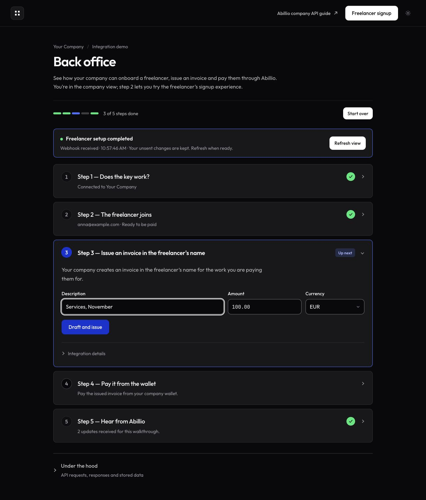

# UX/UI audit — 20 October 2026

The visual foundation is coherent: the company and freelancer views share
type, spacing, field styles, flat surfaces and restrained colors. The main
remaining risks are in completing and recovering the journey. A first-time
visitor can still finish setup without seeing the next action, or reach a
payment without enough financial context.

This is an expert walkthrough, not a user research study or a full
accessibility conformance assessment. Findings below describe the current
local working tree.

## What was checked

- Company fixtures: empty, connected/ready, onboarding in progress, invoice
  retry, payable invoice, completed walk and a requirements error.
- Freelancer signup at desktop and 390 × 844 CSS-pixel viewport sizes.
- Light and dark themes, saved theme selection, keyboard disclosure
  activation and direct links into folded event details.
- A separate local server using the real webhook receiver, SSE route and
  browser script with synthetic, in-memory data and all Abillio API calls
  disabled. A signed synthetic webhook was delivered both while editing a
  form and while the page was idle.
- The implementation paths for popup feedback, error recovery, payment
  context and webhook state updates.

No real onboarding, invoice, payment, deposit or reset was submitted during
this audit. The live Abillio popup and external bank lifecycle were not tested.
The static design fixtures do not run the popup or company live-update script;
the separate local server was used to verify live updates.

## Fixed during this pass

**Incoming updates were invisible and could discard an unfinished form.**
The company view now shows the latest relevant event above the steps, with a
plain-language title, receipt time and webhook/polling source. An idle page
announces its refresh and shows “View refreshed” afterwards. Editing, focused
fields, an in-flight action or a visible error defer background navigation.
“Refresh view” asks before discarding unsent changes; “View event” opens the
enclosing disclosures in step 5.

The event stream also sends an initial snapshot. A missed update can be
detected after reconnection even when the stored log remains at 200 events.
The notification contains a summary, not the underlying event payload.

Browser verification confirmed that “Services, November” remained in the form
after a signed synthetic delivery. A separate idle delivery refreshed via
`GET /`, and the event link opened both nested disclosures. The new behavior
is covered by tests for editing during the refresh delay, in-flight actions,
errors, reconnection, bursts and unavailable browser storage.

## Remaining findings, in priority order

### 1. High — Freelancer completion is hidden in technical details

**Trigger:** The freelancer completes or partially completes the Abillio popup.

**Evidence:** `#status` is inside the initially closed “How this demo connects
to Abillio” disclosure. The popup script writes both the completion message
and the link back to the company there. The visible popup note instead uses
technical state names. This was traced in the rendered structure and code;
the external popup was not completed in this audit.

**Impact:** The form remains the most prominent element when the user should
see “Connected” or an actionable outstanding requirement. Reopening signup
also suggests a new email, which is unsuitable as a resume path.

**Fix:** Give the form area explicit ready, waiting, action-required and
completed states. Keep the success message and next action outside technical
details. A resume action must retain the existing freelancer and mint a fresh
single-use link; it must not reuse a spent URL or start an unrelated signup.

Sources: [join view](../views/join.ts#L23),
[popup feedback](../public/popup.js#L29),
[company onboarding step](../views/company.ts#L47).

### 2. High — A webhook receipt does not reconcile every displayed status

**Trigger:** An invoice or payout changes outside the action currently being
performed in this demo, while `PUBLIC_URL` is configured.

**Evidence:** The webhook receiver appends the event and calls
`recordCompletion`, which updates onboarding. It does not read back the
invoice or payout. The polling fallback is disabled when `PUBLIC_URL` is set.
The demo's own payment/simulation actions perform their own read-backs, which
can hide this gap during a manual happy-path demonstration. This is a
source-traced finding, not a reproduced external bank event.

**Impact:** “Payout completed” can be received and the page refreshed while
the stored payout still has its earlier status. Making the notification
visible does not by itself make the underlying state current.

**Fix:** Reconcile the affected resource after a relevant verified event,
using an authoritative API read. Preserve the existing protections against
late results overwriting another freelancer, a reset or a newer action.
Test delayed, duplicated and out-of-order events.

Sources: [webhook receiver](../server.ts#L439),
[completion writer](../steps/05-events.ts#L112),
[polling configuration](../server.ts#L564).

### 3. Medium — Payment lacks a decision summary

**Trigger:** Open step 4 with an issued invoice.

**Observed:** The action identifies the invoice number but does not show the
recipient, amount due, currency or available wallet balance. The earlier
“Amount” field maps to `unit_price`; its relationship to tax and the final
amount due is not explained.

**Impact:** The visitor can follow the API sequence without understanding
what will actually be charged and paid out.

**Fix:** Show the recipient, invoice amount due and currency before payment,
using values returned by Abillio. Explain the invoice field's tax basis.
Show the relevant wallet balance and reveal funding when it is needed.
Do not infer the total from the entered unit price or conflate invoice
payment with the freelancer's net payout.

Sources: [invoice fields](../views/company.ts#L60),
[payment panel](../views/company.ts#L104),
[stored invoice fields](../lib/store.ts).

### 4. Medium — Errors identify a blocker without providing a recovery path

**Trigger:** A requirements error such as “Identity not verified”.

**Observed:** The white error surface is readable and the relevant step can
reopen, but the error provides codes and a request ID without an action that
resolves the blocker. The error fixture also demonstrates how a green
onboarding completion and an invoicing blocker can appear together; this is
a synthetic display case, not evidence that the backend returned that exact
combination in this audit.

**Fix:** Lead with the affected action and who must act. Offer the appropriate
resume/update flow for the existing freelancer when supported. Explain that
onboarding completion and permission to issue a particular invoice are
different checks. Keep codes and request IDs available as diagnostics.

Source: [error renderer](../views/partials.ts#L97).

### 5. Medium — Mobile gives explanation and completed work too much space

**Observed at 390 × 844:** On signup, the first form fields started around
952px down the document and the primary button around 1232px. On the
payable-invoice fixture, the payment button started around 1005px down the
document. These measurements were taken without a live-update notice.
There was no horizontal page overflow in these checked views.

**Impact:** The prominent first-screen action on signup is “Back to company
view”. The action that moves the visitor forward comes after a long
explanation. In the company view, completed steps increasingly push the next
task down.

**Fix:** On narrow screens, place the form after the short value statement
and move the detailed three-step explanation below it or into a disclosure.
Add a clear jump to the current company step and make completed summaries
more compact. Preserve the order and accessibility of the full walkthrough.

Sources: [signup structure](../views/join.ts),
[company step ordering](../views/company.ts#L158).

### 6. Medium — Webhook setup is presented after the events it should observe

**Trigger:** A fresh local installation with `PUBLIC_URL`, but no subscription.

**Evidence:** “Connect webhooks” lives in step 5, initially folded while earlier
steps are active. Polling is off in this mode. A visitor who follows the five
steps strictly in order may configure the receiver only after generating
onboarding and payment events. Whether subsequent deliveries arrive depends
on later activity; the UI does not explain the dependency.

**Fix:** Surface receiver setup immediately after the company connection, or
show a clear prerequisite link to step 5. Keep the distinction between webhook
delivery and polling. The README now explicitly instructs a fresh installation
to connect webhooks before signup.

Sources: [events panel](../views/company.ts#L131),
[server polling mode](../server.ts#L564).

### 7. Low — Utility actions compete with the task

**Observed:** “Start over” and the header view switch use the same strong
inverse treatment as meaningful secondary actions. On mobile, the view
switch occupies most of the header while the current task can be off-screen.

**Fix:** Keep inverse styling for secondary actions that advance the task.
Make “Start over” a quieter utility action and identify the company/freelancer
view switch as navigation. Keep the theme control understated. Retain the
flat surfaces, full 1px borders and consistent corners already agreed.

Source: [layout and navigation](../views/layout.ts).

## Recommended next pass

First fix the freelancer's visible completion and recovery states, then
reconcile resource status after incoming events. Next add the payment summary
and shorten the mobile path to the form. Refine utility-button emphasis after
those task-level changes, rather than adding more decorative elements.

Validation for this pass: `npm test` — 127 passing tests;
`npm run typecheck` and `git diff --check` passed.
